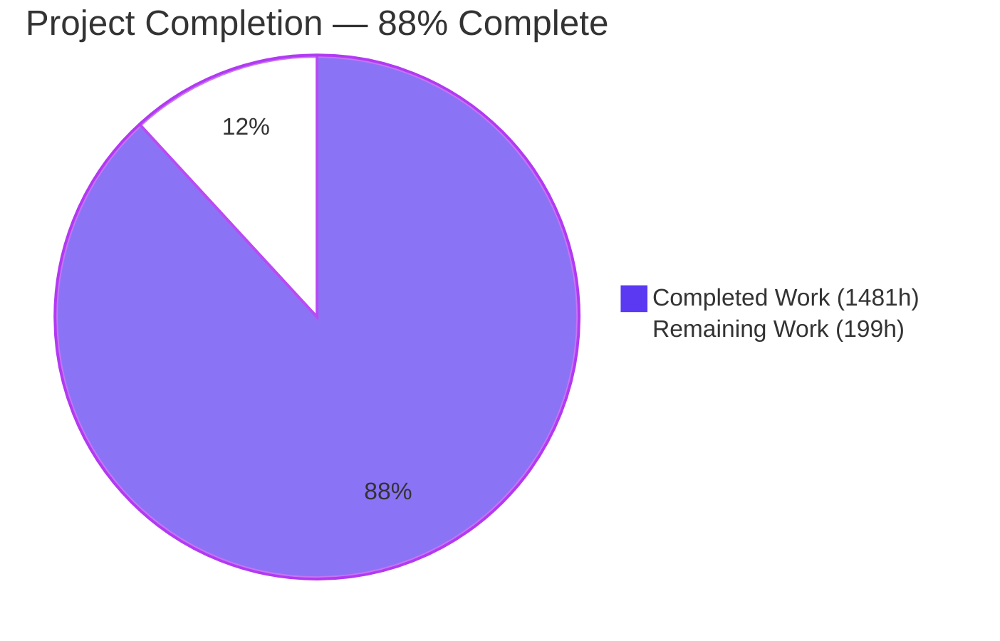
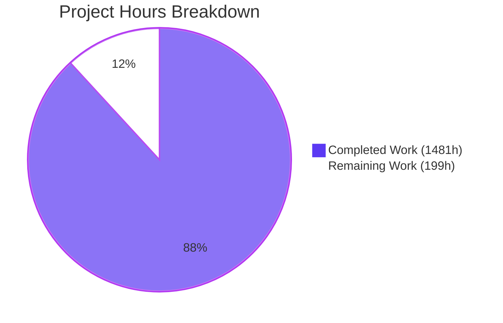
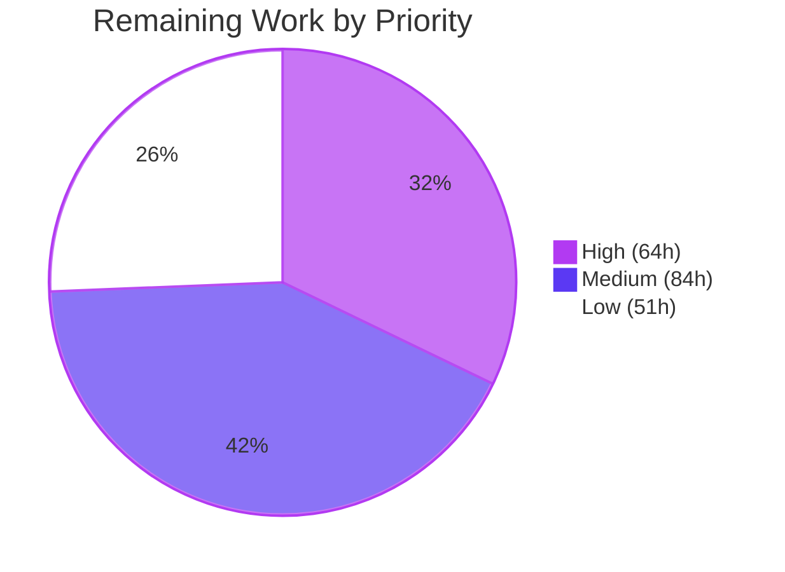

# 1. Executive Summary

What follows is the delivery, the evidence behind it, what remains open, and what comes next.

## 1.1 Project Overview

Site Intelligence, by Gracious Intelligence, is a decision workspace for manufacturers running several plants. A planner sees a disruption, sees what it touches, compares response options with their arithmetic, approves one, watches a simulated write-back, and reads the audit record. The workspace is the FileMap canvas: a map lens and a dependency-graph lens over one scope.

One Vite application on React 19 and strict TypeScript: no server, database, model call or sign-in. An in-browser backend sits behind one typed service interface, and a pure domain core owns every number.

## 1.2 Completion Status

Of the 1,680 hours the plan scopes, 1,481 are complete and 199 remain: **88% delivered** (1,481 ÷ 1,680 = 88.15%). The application builds, runs and passes its gate; what remains is reconciliation against two absent source documents, plus bounded engineering and release work.



| Metric | Hours |
|---|---|
| Total Hours | 1,680 |
| Completed Hours (Baseline: Human with agentic-assist) | 1,481 |
| Remaining Hours | 199 |

Of the 72 requirements the plan scopes, 66 are met in full and 6 in part; fourteen carry open work once the caveats in 1.4 are counted.

## 1.3 Key Accomplishments

- Nine screens across three stages, every one reached from the entry route.
- One typed 46-member service interface, two conformant adapters, one binding point.
- A pure domain core: six solver rows, ten aggregates, a 200-event hash chain, four plant-scoped policies.
- 2,499 unit, component and source-check tests plus 64 browser tests pass in a 6.7-minute gate.
- WCAG 2.2 AA in both themes, no foreign-origin request, and a table view behind every chart.

## 1.4 Critical Unresolved Issues

Fourteen of the 72 scoped requirements still carry open work. None prevents the application from building, running or passing its gate; two need source documents that are not in the repository, and one needs a deployment target.

| Issue | Impact | Owner | ETA |
|---|---|---|---|
| The service interface's member names and its 40 HTTP path constants are derived rather than transcribed from the contracts document | A supplied document may disagree with member and path spellings, needing a reconciliation pass | Service-layer engineer | After the contract document is supplied |
| The expected-results fixtures and the seeded record values are anchored derivations rather than transcriptions | A supplied seed document may move every solver expectation and every seeded figure | Domain engineer | After the seed document is supplied |
| Test titles are not uniformly prefixed with their acceptance identifier | Selecting a test by identifier reaches only the prefixed subset | QA engineer | 1 sprint |
| Two of the sixteen audited actions are unnamed | The audit action type stays an open alias rather than a closed union | Service-layer engineer | After the contract document is supplied |
| Evidence reach is incomplete: the overview's two chart marks narrow the queue instead, a projected-stock point opens the exception record behind it, and a mark with no resolvable record family opens nothing | Some evidence sits one activation further, in the mandatory table view | Front-end engineer | 1 sprint |
| The comparison matrix's own table takes fixed cell padding and does not follow the density switch | One screen's rows stay fixed while the rest of the shell moves | Front-end engineer | 2 days |
| The evidence drawer's four section titles are paragraphs, not headings | Heading navigation does not reach them | Front-end engineer | 1 day |
| The loading state is observable only on a fresh read, not on an already-rendered one | The state cannot be demonstrated mid-session | Front-end engineer | 2 days |
| Alternate-source readiness is computed and carried in the overview payload but has no tile on the screen | The figure is reachable only through a figure's evidence | Product owner and front-end | 1 sprint |
| Six stage-notice routes are reachable by address only, because their navigation entries are disabled controls that cannot be followed | Navigation coverage stops at the routes a visible control offers | Front-end engineer | 1 day |
| Thirteen branches carry no discriminating test | A refactor could break them without a failure | QA engineer | 2 sprints |
| The unconnected API client is never bound at runtime | Its correctness rests on the type check, the conformance suite and unit cases | Service-layer engineer | 1 sprint |
| Two reader-facing decisions are unsettled: whether a reset returns the session to the seeded persona, and whether the export sentence names permissions or roles | Session behaviour and one disabled reason stay as built | Product owner | 1 week |
| No CI wiring, publish step or release checklist exists | The built bundle cannot yet be deployed by a pipeline | Release engineer | 1 sprint |

## 1.5 Access Issues

Three resources stand between the current state and a release; the toolchain itself is complete.

| System/Resource | Type of Access | Issue Description | Resolution Status | Owner |
|---|---|---|---|---|
| Contract documents — the service interface, the audited action list and the HTTP path list | Source document | Not present in the repository, its history or its attachments, so the interface and path vocabulary are documented derivations | Open — gates the reconciliation task | Product owner |
| Seed data document — the expected-results table and the expected aggregates | Source document | Not present, so the expected-results fixtures are anchored derivations rather than transcriptions | Open — gates the transcription task | Product owner |
| CI runner and static host | Deployment access | Neither is configured; the bundle is built and served on loopback only | Open — path to production | Release engineer |
| Chromium browser binary | Test dependency | Present in the shared Playwright cache and used by the 64-test browser suite | Available | QA engineer |
| Node 26 toolchain | Runtime | Present at v26.13.1; the engine-strict setting rejects any other major | Available | — |

## 1.6 Recommended Next Steps

1. **[High]** Obtain the contract and seed documents and reconcile the interface, the paths, the fixtures and the seeded values against them.
2. **[High]** Wire the gate into CI and publish the static bundle to a host with a release checklist.
3. **[Medium]** Close the audit-action vocabulary and add a discriminating case for each of the thirteen untested branches.
4. **[Medium]** Finish evidence reach on marks, points, nodes and series, and put the comparison table on the density switch.
5. **[Low]** Settle the two reader-facing decisions, the readiness surface and the drawer's heading semantics.

# 2. Project Hours Breakdown

The hours below are the plan's own scope: 1,481 hours of delivered work across 23 requirement groups, and 199 hours of work that remains — reconciliation against two source documents that are not in the repository, eight bounded engineering tasks, and the path to a deployable bundle.

## 2.1 Completed Work Detail

| Component | Hours | Description |
|---|---|---|
| Shell, routing and navigation | 72 | 14 modules under `src/app`, 13 navigation entries in three groups plus further routes, the not-found and stage-notice pages, the role switcher, the simulation popover, the freshness strip, the sovereignty pill, identifier search and the keyboard model; 15 colocated suites, 181 tests |
| Design tokens, both themes, density and the shared component library | 190 | `command.css`, `paper.css`, `tokens.css`, the theme provider and the two switches, plus 30 shared modules — status indicator, badge, tooltip and action button, state boundary, forbidden card, data table, mono value, evidence drawer, tiles, frame, four SVG charts, map, dependency graph, timeline dock, legend, form fields and the shared screen-state and graph-vocabulary modules; 35 suites, 949 tests |
| Service port, binding point and provider | 48 | The 46-member `SiteIntelligenceService`, `create-service.ts` as the only selection point, the provider with its async bootstrap, the demonstration capability, the write-to-read invalidation map and the conformance proof |
| In-browser mock backend | 145 | Seeded mutable state, deterministic 150-400 ms latency, the simulation flags, the seed loader, the assistant builders, nine handler families, message-level redaction, the write-conflict guard, and permission and policy enforcement; 6 suites, 193 tests |
| Unconnected API client, 40 path entries and transport | 40 | `api-client.ts`, `paths.ts` and `http.ts` with same-origin containment, implementing the port against the documented paths and never bound at runtime; 2 suites, 129 tests |
| Seed record set and deterministic filler | 90 | 28 typed record modules from plants to assistant questions, the deterministic generator, the 200-event audit trail and its load-time invariant guard |
| Solver, working-day calendar and rounding | 48 | The eleven ordered solver rules, the only two rounding helpers in the codebase, and six fixture rows reproducing the plan's own anchors; 2 suites, 136 tests |
| Aggregates and scope resolution | 42 | Overview, exception, ledger and urgency aggregates over one resolved scope; 1 suite, 79 tests |
| Append-only hash chain and verification | 30 | Canonical JSON, SHA-256 through the platform digest, chain append and a verification that reports every break; 1 suite, 21 tests |
| Policy engine and permission matrix | 42 | Four evaluated policies with POL-009 declared and never evaluated, the permission matrix with plant scoping, prototype-safe lookups and the forbidden card that mirrors a refusal; 1 suite, 82 tests |
| Screens SCR-01 to SCR-07 | 240 | Overview, exception queue, investigation, scenario comparison, approvals and audit, evidence assistant, sovereignty and policies — each with its charts, tables, primary action and fixed empty or disabled text; 14 suites, 481 tests |
| FileMap canvas SCR-12 | 96 | Map lens with three zoom levels and five view presets, graph lens with six lanes, dimming and path tracing, selection carried across lenses, timeline dock, pins by state, wall mode and a table view on both lenses; 4 suites, 70 tests |
| Competitive atlas SCR-13 | 78 | Pack banner, selectors, competitor network, five-axis radar, chokepoint table, chokepoint alert strip, canvas overlay and halos, and the brief export; 3 suites, 60 tests |
| Evidence drawer and reference families | 54 | The four-section drawer with focus trapping and focus return, nine record families plus the solver-case family, redaction and the refusal wording for an unresolved reference |
| Seven screen states and the simulation popover | 36 | One boundary with a rendering per state, nine triggers reachable only from the single popover, the tampered event and the emptied queue |
| Simulation labelling and the persistent badge | 18 | The seven exact labels owned once and carried per element, with the badge mounted in the shell above the router outlet alongside the demonstration clock |
| Three browser-built exports | 24 | Evidence pack, scenario CSV and chokepoint brief, each carrying `"simulated": true`; 3 suites, 42 tests |
| Identifier search | 18 | Grouped by entity type, opening the record's own screen or the evidence drawer |
| Browser acceptance suite | 84 | 13 Playwright specs and 64 tests: the planner journey, per-screen acceptance, the seven states, the per-route axe sweep in both themes, the request-origin listener and the built-bundle scans, with four shared helpers |
| Six source checks and the fixture boundary | 36 | No seed import outside the adapter, no barred vocabulary, no typed figure, no `any` in the two layers, no credential or environment read, and every required README heading — 54 cases over three fixture modules |
| Toolchain, configuration and committed lockfile | 24 | `package.json` with seven scripts and exact pins, the lockfile, the strict `tsconfig`, the Vite and Playwright configuration, the single entry document, `.nvmrc`, `.npmrc` and `.gitignore` |
| Bundled assets | 12 | Four self-hosted woff2 faces, two font licence texts, the Natural Earth 110m boundary module and its licence note |
| README with the eleven required headings | 14 | Run, test, build, the role switcher, the simulation controls, the mock-to-API-client mapping, what is simulated, what a real deployment must supply, licences, packages and configuration |
| **Total** | **1,481** | |

## 2.2 Remaining Work Detail

| Category | Hours | Priority |
|---|---|---|
| Reconcile the service interface's 46 members and the 40 path constants against the contract documents, replacing the derived vocabulary — traceable to the typed-service and API-surface requirements | 40 | Medium |
| Transcribe the seed document's expected-results table and expected aggregates over the two fixture modules and the seeded record values, then re-anchor the six solver rows and the ten aggregate expectations — traceable to the computation and expected-result requirement | 48 | High |
| Name and append the last two audited actions when the audited-action list is supplied, closing the audit action alias into a union — traceable to the append-only chain requirement | 8 | Medium |
| Bring the suite's titles to the identifier rule, or retire that rule from the plan — traceable to the acceptance-identifier requirement | 16 | Low |
| Extend evidence families and triggers to topology nodes, atlas series and projected-stock points, and let the overview's two chart marks open evidence without losing the queue narrowing — traceable to the evidence requirement | 12 | Medium |
| Bring the comparison matrix's own table onto the 32/44 px density switch — traceable to the design-system requirement | 3 | Low |
| Give the evidence drawer's four section titles heading semantics — traceable to the accessibility and evidence requirements | 2 | Low |
| Make the loading state observable on an already-rendered read rather than only on a fresh one — traceable to the seven-states requirement | 4 | Low |
| Decide and record the alternate-source-readiness surface, a computed figure the overview payload carries without a tile | 6 | Low |
| Reach the six stage-notice routes through a visible control, or retire the navigation rule for them — traceable to the navigation requirement | 3 | Low |
| Add one discriminating case for each of the thirteen branches no test reaches | 24 | Medium |
| Exercise the unconnected API client and its payload descriptors against a stub transport | 12 | Low |
| Settle the two reader-facing decisions: whether a reset returns the session to the seeded persona, and whether a missing permission names roles or permissions in the export sentence | 5 | Low |
| Path to production: wire the single gate into CI, publish the static bundle to a host, write the release checklist and reconcile the README's package table, provenance notes and test count with the code | 16 | High |
| **Total** | **199** | |

## 2.3 Hours Reconciliation

The three figures reconcile arithmetically and are the same figures used in Sections 1.2 and 7.

- Section 2.1 sums to **1,481 hours** of completed work across 23 requirement groups.
- Section 2.2 sums to **199 hours** of remaining work across 14 categories.
- 1,481 + 199 = **1,680 total hours**.
- 1,481 ÷ 1,680 = **88.15%**, reported as 88% throughout.

By priority, the 199 remaining hours split into **64 hours High** (the two reconciliation passes against the absent source documents and the path to production), **84 hours Medium** (the first reconciliation of the interface and paths, the audited-action vocabulary, evidence reach and the thirteen unexercised branches) and **51 hours Low** (the seven bounded refinements, the test-title convention and the two reader-facing decisions).

# 3. Test Results

Every count below comes from a run on this repository at commit `cce8a05`, the tip the work ends on: `npx tsc --noEmit` exit 0 with zero diagnostics, `npx vitest run` exit 0 with 96 files and 2,499 tests passing in 243 seconds, `npm run build` exit 0 with 4,864 modules transformed, and `CLONE_INDEX=71 npx playwright test` exit 0 with 64 tests passing in 2.4 minutes against the built bundle served on `http://127.0.0.1:20710`. No coverage percentage is claimed, because no coverage tool is installed and the plan sets no threshold.

| Area / Category | Framework | Tests | Passed | Failed | Coverage | What This Proves |
|---|---|---|---|---|---|---|
| Domain arithmetic — solver, aggregates, audit chain, policy engine | Vitest, node environment | 318 | 318 | 0 | Not measured | The eleven solver rules reproduce all six expected-results rows, the aggregates follow their rules over records, the hash chain verifies and names each break, and the four policies deny with their rule and reason |
| Shared component library | Vitest, jsdom | 949 | 949 | 0 | Not measured | Every primitive owns its semantics and role tokens, a disabled control cannot render without its reason, a chart cannot ship without its table view, and a status cannot render without icon, label and colour |
| Application shell | Vitest, jsdom | 181 | 181 | 0 | Not measured | The top bar order, the navigation table with its stage tooltips, the badge above the router outlet, the persona roster, scope filters, search, the simulation popover and the keyboard model behave as specified |
| Nine screens, SCR-01 to SCR-07 and SCR-12, SCR-13 | Vitest, jsdom | 545 | 545 | 0 | Not measured | Each screen renders its charts, tables, primary action and fixed empty or disabled text from service data, with no typed figure and no fabricated reference |
| Service layer — mock adapter, API client, exports, provider, conformance | Vitest, node and jsdom | 385 | 385 | 0 | Not measured | Both adapters implement the same 46 members, the mock enforces permissions, policies, redaction and write conflicts, the three exports carry `"simulated": true`, and every write invalidates the reads it moved |
| Six source checks and the fixture boundary | Vitest, node | 121 | 121 | 0 | Not measured | The seed boundary, the no-typed-figure rule, the `any` ban in the service and type layers, the credential and environment ban, the barred vocabulary and the README headings all hold across `src` |
| Browser acceptance suite, including the bundle scans | Playwright on Chromium | 64 | 64 | 0 | Not measured | The planner journey completes end to end with the solver's figures on screen, every route states its seven states, axe is clean in both themes, no request leaves the origin, and the built bundle carries no barred name, placeholder text or credential |

**Not Covered**

- The unconnected API client is never bound in the running build, so no served route exercises it; its correctness rests on the type check, the 46-member conformance suite and 129 unit cases.
- Thirteen branches have no discriminating case: the option builder's catch arm, a fourth competitor slot, the idle-window rule with non-contiguous zero days, the node-reach guard for a node the records place in no plant, the atlas pack-classification failure arms, the tooltip's width cap, the policy engine's lookup action (which has no runtime caller), the router's location-state rejection, the assistant's partial notice, the outcome card's not-landed branch, the zero-option export marker, the origin node family's drawer, and the role switcher's no-capability branch.
- The loading state has no test on an already-rendered read, because a cached read is not refetched.
- The six stage-notice routes are asserted by address rather than through a visible control, because their navigation entries are deliberately disabled.
- The routes for the six data sources, the four models, the plan grid and the exit package are implemented for interface conformance and no screen calls them, so their behaviour is asserted by unit cases only.
- A human releasing this should drive, once, on a real device: the layout below 768 px, the drawer as an overlay below 1280 px, and the reduced-motion path on the canvas animations.

# 4. Runtime Validation & UI Verification

Driven in headless Chromium against the production bundle served by `vite preview` on loopback, at the suite's 1440x900 viewport, with the console and every request watched. Narrow-width behaviour is exercised through the same responsive rules rather than as a separate device pass, which the Not Covered list in Section 3 records.

- ✅ Build and startup — `npm run build` emits the bundle (4,864 modules, 327 ms) and `vite preview` serves it; `npm run dev` is ready in 156 ms and answers HTTP 200 for both the entry document and the root module.
- ✅ Shell, navigation and persona switching — the top bar, the 13 entries in three groups, the role switcher, the theme and density switches, and the identifier search all operate; switching persona moves the session to that persona's entry route without a reload.
- ✅ Planner journey end to end — disruption → impact chain → options with their arithmetic → approval requested as one persona and decided as another → simulated write-back steps → the audit record naming both, with the on-screen figures equal to the solver's output.
- ✅ The seven states — loading, empty, stale, partial, offline, forbidden and conflicting update all render, driven only from the single simulation popover; the conflicting-update state replaces the record and the emptied queue leaves the queue and the overview agreeing that nothing is open.
- ✅ FileMap canvas — map and graph lenses over one selection, three zoom levels, five view presets, pins by state, the timeline dock resolving the exception a selected plant answers, wall mode, and the table view on both lenses.
- ✅ Competitive atlas — the simulated-pack banner, the product-class selector, the network with shared chokepoints, the five-axis radar with separately labelled series, the chokepoint table, the alert strip and the brief download.
- ✅ Accessibility — axe with the four WCAG tags on every route in both themes, zero serious or critical violations, keyboard operation with a visible focus ring throughout.
- ✅ Offline containment and the built bundle — no request to a foreign origin on any route in either theme; 32 built files and 26 served assets carry no barred product name, no real vendor name, no placeholder Latin and no credential shape.
- ⚠ Evidence reach — a figure, a table row, a record trigger and a pin open the drawer, but the overview's two chart marks narrow the queue instead, a projected-stock point opens the exception record behind it, and a mark with no resolvable record family opens nothing.
- ⚠ Never exercised at runtime — the unconnected API client (deliberately unbound) and the six stage-notice routes through their intended navigation entry, whose controls are disabled.

# 5. Compliance & Quality Review

Each deliverable is held to the benchmark the plan sets for it, and each row states where the deliverable stands now rather than how it got there.

## 5.1 Compliance Matrix

| Deliverable | Benchmark | Status | Evidence |
|---|---|---|---|
| Typed service boundary with two adapters | One interface, no bypass, one binding point | ✅ Pass | 46 members on both adapters, proven by a conformance suite and a source check that no seed record is imported outside the adapter |
| Computed figures only | No number typed into a component or template | ✅ Pass | A source check over the feature and component folders plus the assistant builders; expected results live only in `tests/fixtures` |
| Accessibility — WCAG 2.2 AA | Keyboard, focus ring, contrast, reduced motion, axe on every route | ✅ Pass | Per-route axe sweep in both themes with zero serious or critical violations; 24x24 px targets with the specification's equivalent exception |
| Simulation labelling | Every required element carries its exact label | ✅ Pass | The seven labels owned once in `src/types/primitives.ts` and asserted per element; the badge mounted above the router outlet |
| Offline runtime | No third-party request at runtime | ✅ Pass | Bundled fonts, icons and boundaries; a request listener on the browser context across every route in both themes |
| Secrets and configuration | No credential, no environment read, documented empty set | ✅ Pass | Source and bundle scans; the README's configuration table states the application defines no variable |
| Audit chain | Append-only, verifiable, labelled as a demonstration | ✅ Pass | 200 seeded events hashed through the platform digest; a tampered event reported at sequence 142 and repaired by nothing |
| Permissions and policy | Enforced by the service, explained by the UI | ✅ Pass | Matrix with plant scoping in the adapter; four policies evaluated; denials carry the rule, the reason and the trace identifier |
| Determinism | Same input, same output | ✅ Pass | The solver is a pure function; running the same case twice is an assertion, and no domain module reads the clock or a random source |
| Type safety | Zero errors, no `any` in the service and type layers | ✅ Pass | `tsc --noEmit` exit 0 across source, tests, browser specs and both configuration files; an 11-case source check |
| Reproducible install | Exact pins, committed lockfile | ✅ Pass | Every dependency at an exact version; `npm ci` and `npm ls` both clean |
| Documentation | Every required topic as its own heading | ✅ Pass | Eleven headings present and asserted by a source check |

## 5.2 AAP & Rule Divergences and Gaps

Twenty-two departures from the plan or the rules were established, each a fact about the delivered code. Three are sanctioned by a source that ranks above the plan — the user's rules, or the plan's own recorded exclusions — and are marked as such.

| What the AAP/Rule Required | What Was Delivered Instead | Why It Diverged | Impact | Remediation |
|---|---|---|---|---|
| The service interface is the contract document transcribed verbatim, and its path list holds exactly 34 constants (plan §0.6.2, §0.12.1, §0.12.3) | 46 members, each derived from a capability the plan names with its derivation recorded on the member, and 40 path entries | The contract document is not in the repository, its history or its attachments, and the plan forbids inventing its content | The interface is complete and checkable but not provably the document's text; the path count differs by six | Supply the document and reconcile member by member against `src/services/site-intelligence-service.ts` |
| The expected-results fixtures hold the seed document's §4 and §13 tables verbatim (plan §0.8) | Both fixture modules hold documented derivations, anchored to the figures the plan itself quotes and to the seeded records | The seed document is absent, and typing invented values would breach the no-typed-figure rule | The acceptance chain runs through the plan's anchors and the seeded records rather than the document | Supply §4/§13 and transcribe over `tests/fixtures`; no consumer changes |
| Every test title begins with its specification identifier (plan §0.7) | Acceptance suites are identifier-prefixed; component, source-check and journey suites carry descriptive titles | The plan's sentence is broader than the suites its own file plan enumerates | Selecting a test by identifier reaches only the prefixed subset | Rename the remaining titles, or retire the sentence; the README already states which suites carry identifiers |
| The six source checks ship with the foundation and are green at all three stage gates (plan §0.9, §0.15.2) | The checks and the bundle scans exist and pass, but they entered the tree near the end of the build | Commit order cannot be rewritten by a later change | The earlier stages were not gated by them; the tree as it stands is | Land each later stage's checks with its foundation commit |
| Twenty-one packages in total, each at an exact version (plan §0.11.1) | 25 declared: the 21 named plus `@types/d3-geo`, `@types/react`, `@types/react-dom` and `@types/topojson-client` | react, react-dom, d3-geo and topojson-client ship no type declarations, and `tsc` fails on every JSX element without them | Four development-only entries; none reaches the runtime bundle | Add the four to the plan's list, or move to packages that ship their own types |
| The ledger aggregate depends on types only (plan §0.12.1) | `ledger.ts` also imports `dayNumberFromIsoDate` from the solver's calendar | The calendar is the single civil-date module and the ledger needs a day number | One extra acyclic dependency on a pure module | Accept, or inline the helper |
| The demonstration capability is `switchRole` alone (plan §0.12.1) | It also declares `getActiveUser` and `listPersonas` | Per-persona density and the persona's entry route cannot exist without a persona read, and the port itself is fixed | Three members instead of one; the port and the unconnected client are unchanged | Record the three members in the plan's row |
| `ExceptionRow` carries exactly the twelve queue columns and no field is added (plan §0.12.2) | Adds `alsoAffectsPlantIds`; `ExceptionQuery` gains an optional `date`; `Atlas` gains `packVersion` | A row must show which plants it reaches, the series' dates must narrow the queue, and the brief needs a release label | Additive only — no column, order or figure changed | Accept the additions in the plan's derivation rows |
| The topology carries four node families (plan §0.12.2) | Five — materials added, with lanes and an empty-state note | The specification's graph lanes and the canvas acceptance test both require a material family | One more payload array and one more populated lane | Reconcile the plan's topology row with the specification |
| 23 shared components enumerated (plan §0.5.2) | 30 shared modules | The plan's own rule forbids a screen rendering a native element, so every element needs an owner | A larger but still bounded primitive layer, each module with its own suite | Add the five field and dialog primitives and the two shared modules to the inventory |
| The export builders live under `src/services/mock/exports/` (plan §0.12.1, §0.15.1) | The shared composers live in `src/services/exports/`; the plan-named modules remain as delegating assemblers | Both adapters must serve the same document, so the composition cannot be mock-private | One extra folder; the plan's paths exist and delegate | Amend the file plan to name the shared folder |
| One money formatter lives in `src/components/mono-value.tsx` (plan §0.8) | It lives in `src/types/figure-text.ts`, and `mono-value.tsx` re-exports it | A service module may not import a component, and the export must reproduce the screen's money text | No behavioural change, one indirection | Amend the plan's module row |
| A reload or a demo reset restores the seed (plan §0.2.1) | The reset restores records, hashes, triggers, pending policy requests and the request counter, and keeps the acting persona | Reverting the persona signed the reader out and stranded an administrator on a permission card | No record, figure, hash or trigger differs | Decide whether a reset should also return the seeded persona, and say so in the control's description |
| A missing permission disables the control with the role that may act named (plan §0.2.2) | The sovereignty export sentence names the two permissions required; the roles appear on the forbidden card the same refusal raises | No port member publishes the role-to-permission matrix, and importing the matrix into a screen would create a second authority | The reader learns which permission blocks the action, one card away from which roles hold it | Add a port read for the roles that hold a permission, or amend the plan |
| Every figure on screen opens the evidence drawer from its own surface (plan §0.12.4, F12) | The overview's two chart marks narrow the queue; a projected-stock point opens the exception record behind it; a mark with no resolvable record family opens nothing | A mark cannot both open a screen-level dialog and leave the screen for the queue it narrows, and fabricating a reference would breach the no-typed-figure rule | Every overview figure's evidence stays reachable in the mandatory table view, one activation further | Extend the evidence families to nodes, series and points, or add a shell-level drawer |
| The disabled "Open part" control sits on product and material nodes (plan §0.10) | Delivered on material nodes; no product node family exists | No record places a product at a site, and product profiles belong to a later stage | Nothing in the interface claims a product node | Add the family when the part-viewer stage arrives |
| Every competitor name carries "Simulated company" (plan §0.10) | Every competitor name carries "Synthetic company" | **Sanctioned** — the user's rule P-5 fixes that literal and ranks above the plan | None: the governing source is followed | Correct the plan's companion-string row |
| No number is typed into a component, a template or a test hook (rule P-6) | The transport's failure message states its 10,000 ms deadline | **Sanctioned** — a protocol constant that classifies a transport outcome, not a business figure | None on any displayed figure | Accept, or reduce the sentence to "within its deadline" |
| The plan's recorded exclusions and the host's port requirement | `three` absent; the design tool's backdrop and hairline not adopted; the IPv4 loopback origin used with a per-checkout derived port | **Sanctioned** — the plan records these exclusions itself, and the environment requires a derived port on a shared host | None | Nothing |
| The ignore file holds exactly the six artifact patterns (plan §0.13.1) | Exactly those six: the twelve extras and the one negation were removed | The plan fixes that content precisely | Editor, coverage and log patterns are no longer ignored | Re-add any pattern the team relies on |
| The application defines no environment variable at all (plan §0.9) | The configuration table names `CLONE_INDEX` and `PREVIEW_PORT` as the only variables read anywhere, by the browser-test configuration | The table as written contradicted the test configuration that selects a loopback port on a shared host | The application itself still declares no variable | Accept, or widen the plan's sentence to cover the harness |
| The no-typed-figures check scans the feature, component and app folders and the assistant builders (plan §0.9) | The money rule moved to `src/types`, which that subject does not scan | A service module may not import a component, so the formatter had to move | The scan no longer sees the formatter's currency-code option | Widen the check's subject to cover the figure-text module |

**The two reconciliations gate the release.** The service interface's 46 member names and the 40 path constants were derived, with each derivation recorded on the member it produces, because the contract document that would fix them is not in the repository, its history or its attachments. That makes the interface complete and checkable — both adapters implement all 46 members and a conformance suite proves it — but not provably the document's own text. The same is true of the path list, which holds 40 entries where the plan says 34 because the plan does not enumerate the set. A human must supply the document and diff the two files against it; the member list in `src/services/site-intelligence-service.ts` and the per-entry notes in `src/services/api-client/paths.ts` are written as the checklist for exactly that pass.

**The expected results are anchored, not transcribed.** Both fixture modules under `tests/fixtures` hold documented derivations rather than the seed document's tables, anchored at the points the plan itself quotes: the 580 and 640 units late for `CO-770233` and `CO-770251`, their 1,220 total, the 21,300 spend, the 2,257,000 of delayed revenue, and the 78 percent readiness of `PPAP-0219`. The seed document is absent, and inventing values would breach the rule that every number comes from the solver or the records. A human must supply §4 and §13, transcribe over the fixtures and the seeded record values, and re-run the gate; no consumer, type or export changes when that happens.

**Four dependencies are declared beyond the plan's package list.** `@types/react`, `@types/react-dom`, `@types/d3-geo` and `@types/topojson-client` are development-only declarations for four packages that ship none of their own. Without them `tsc` reports a missing declaration for `react` and `react/jsx-runtime` and on every JSX element, so the plan's own zero-error requirement cannot be met with the 21-package set. They add nothing to the runtime bundle, make no request and hold no secret. A human decides whether the plan's count or the manifest is authoritative; the README's package table already explains each of the four.

**A reset keeps the person who is signed in.** The plan says a reset restores the seed, and it does — records, hashed chain, triggers, pending policy requests and the request counter all return to their seeded state. It does not revert the acting persona, because doing so silently signed the reader out and stranded an administrator on a permission card. The behaviour is defensible either way and the control's own description does not promise one, so a human should decide it and make the description say whichever answer they choose.

**One disabled reason names permissions rather than roles.** The plan asks a disabled control to name the role that may act. The sovereignty screen's export control names the two permissions the adapter requires instead, because no port member publishes the role-to-permission matrix and reading the matrix from a screen would create a second authority that could disagree with the one the service enforces. The roles are one card away, on the forbidden card the same refusal raises, and the service refuses independently either way. Closing it needs a port read that lists the roles holding a permission, which is a small, well-bounded addition.

**Evidence reach is one activation short in three places.** Every figure, table row, record trigger and pin opens the four-section drawer. On the overview, the two chart marks narrow the queue instead, because a mark cannot both open a screen-level dialog and leave the screen for the queue it narrows; their evidence stays reachable in the mandatory table view every chart carries. A projected-stock point opens the exception record that carries the projection, and a mark whose record family the evidence read cannot resolve stays inert rather than fabricating a reference. Extending the evidence families to nodes, series and points would close the gap without changing a screen.

**Test titles mix two conventions.** Acceptance suites begin with their identifier, so one test runs by name — `npx vitest run -t "T-17"` and `npx playwright test -g "T-07"` both work — while component, source-check and journey suites carry descriptive titles, and the README says which is which. The plan asks for the identifier everywhere; its own file plan, however, enumerates colocated suites that assert a component's contract rather than an acceptance criterion. A human should either rename the remaining titles or retire the sentence, and the documentation already describes the delivered state either way.

**The six source checks arrived late in the build.** They exist, they pass, and they hold the boundaries this guide describes: no seed import outside the adapter, no typed figure, no `any` in the service and type layers, no credential or environment read, no barred vocabulary, and every required README heading. But they entered the tree near the end rather than with the foundation, so the earlier stage gates did not run them, and no later change can rewrite that order. The remedy is a rule for the next stage rather than work on this one: land each stage's checks with its foundation commit.

# 6. Risk Assessment

| Risk | Category | Severity | Probability | Mitigation | Status |
|---|---|---|---|---|---|
| The derived interface member names and the 40 path constants may disagree with the contract document when it is supplied | Technical | Medium | High | Diff the member list in `src/services/site-intelligence-service.ts` and the per-entry notes in `src/services/api-client/paths.ts` against the document before any real integration | Open |
| The anchored fixtures and the authored seeded values may move every solver expectation when the seed document arrives | Technical | High | Medium | Transcribe the document's two tables and re-anchor the six solver rows and ten aggregate expectations in one pass, then re-run the gate | Open |
| Thirteen branches carry no discriminating test, so a refactor could change them silently | Technical | Medium | Medium | Add one case per branch that fails on a deliberate mutation of that branch | Open |
| A real backend swap is unproven beyond type conformance and unit cases, because the HTTP client is never bound | Integration | Medium | Medium | Point the client at a stub transport in the gate and assert request formation and error mapping | Open |
| The audited-action type is an open alias, so a new spelling compiles without complaint | Technical | Low | Medium | Close it into a closed union when the action list is supplied | Open |
| No monitoring, telemetry or analytics exists, by the rule that forbids third-party requests | Operational | Medium | Low | Add observability at the static host rather than in the client, and keep the client's offline property intact | Accepted |
| Session state is in memory: a reload re-seeds the records, and a reset keeps the acting persona | Operational | Low | High | Document both behaviours for demonstration users, and settle the reset semantics so the control's description matches | Accepted |
| The permission matrix is demonstration-wide, and the external supplier engineer's vendor scope resolves to no records | Security | Low | Low | The gap is fail-closed — it releases nothing rather than too much — and widening it must be a deliberate seeded or matrix change | Accepted |

# 7. Visual Project Status

Completion and remaining effort against the 1,680 hours the plan scopes:



How the 199 remaining hours are prioritised:



| Band | Hours | What it covers |
|---|---|---|
| High | 64 | The two reconciliation passes against the absent source documents, and the path to a deployable bundle |
| Medium | 84 | The first interface and path reconciliation, the audited-action vocabulary, evidence reach and the thirteen unexercised branches |
| Low | 51 | The test-title convention, seven bounded refinements, the unconnected client's exercise and two reader-facing decisions |

# 8. Summary & Recommendations

Site Intelligence is delivered at **88% of the plan's scoped hours** — 1,481 of 1,680 — and it is a working application rather than a scaffold. All three stages the plan scopes are present: the decision loop and governance screens, the FileMap canvas with both lenses, and the competitive atlas with its network, radar, chokepoint table and brief export. Every screen and component is reached from the entry route through the visible interface, the planner journey runs end to end with the solver's figures on screen, and the whole gate — type check, 2,499 unit, component and source-check tests, a production build, and 64 browser tests including a per-route accessibility sweep in both themes — passes in about 6.7 minutes against a ten-minute budget.

What makes the delivery dependable is not the feature count but the enforcement. One typed service interface with two conformant adapters and a single binding point means no screen can reach a data source directly, and a source check proves it. Every number comes from a pure domain function, and a second source check proves no figure is typed into a component. The audit chain hashes 200 seeded events through the platform digest and reports a tampered event at its exact position while repairing nothing. Four policies deny with the rule and a plain reason, and the permission matrix with plant scoping is enforced in the adapter, so a disabled control is an explanation rather than a defence. Accessibility is a test rather than a claim, and the built bundle requests nothing from a third-party host.

The gaps that remain are narrow and known. Fourteen of the 72 scoped requirements carry open work, and none of them stops the application from building, running or passing its gate. Two are reconciliations against source documents that are not in the repository: the interface's 46 member names and 40 path constants are documented derivations, and the expected-results fixtures are anchored derivations rather than transcriptions. Both pass every check the tree can run; both become exact the moment the documents are supplied. The rest are bounded engineering tasks — evidence reach on three surfaces, the density switch on one table, one open audit-action alias, thirteen untested branches, and a deployment pipeline.

The critical path to production is three steps. First, obtain the two source documents and reconcile the interface, the paths, the fixtures and the seeded values against them. Second, wire the single gate into CI and publish the static bundle to a host, with a release checklist that names the gate, the bundle scans and the no-configuration requirement. Third, close the audited-action vocabulary and add the missing branch cases so the next change cannot break a branch silently. The two reader-facing decisions — whether a reset returns the seeded persona, and whether a disabled export names permissions or roles — belong in the same pass, because each changes wording a user reads.

Production readiness, in the terms this build is meant for: ready as a demonstration, not yet ready as a deployed product. The demonstration is complete, honest about what is simulated, and secured at the layer that matters — the service, not the view. What a deployment must add is named in the README and unchanged by this assessment: a real implementation behind the existing HTTP client, connectors for the six sources, identity and authorisation replacing the role switcher, an EU processing boundary with an in-boundary model, a customer-controlled document viewer, and a tamper-evident store behind the audit chain. Success for this milestone is the gate staying green while the plan's own figures — 580 and 640 units late, 1,220 in total, 21,300 spent, 2,257,000 protected, 78 percent readiness — reproduce from the seeded records on every run.

# 9. Development Guide

### Prerequisites

- **Node 26.** The manifest pins `engines.node` to `>=26.0.0 <27` and `.npmrc` sets `engine-strict=true`, so any other major fails the install instead of warning. Node v26.13.1 with npm 11.20.0 is what every command below was run on.
- **npm**, which installs exactly the committed `package-lock.json`.
- **A Chromium build**, needed only by the browser suite. It is installed once, out of band, and no test downloads anything at run time:

```bash
npx playwright install chromium
```

No other prerequisite exists. There is no database, no service address, no model endpoint, no identity provider and no `.env` file, and nothing in `src` reads an environment variable.

### Install

From the repository root:

```bash
npm ci
```

Expected: about 129 packages in a few seconds, `found 0 vulnerabilities`, and no `EBADENGINE`. `npm ci` fails if the manifest and the lockfile disagree, which is the point of using it rather than `npm install`. `node_modules/`, `dist/`, `test-results/` and `playwright-report/` are per checkout and ignored by git.

Confirm the dependency graph resolves:

```bash
npm ls --depth=0
```

Expected: exit 0 and no `invalid`, `missing` or unmet-peer line.

### Run in development

```bash
npm run dev
```

Expected: `VITE v8.3.8 ready` in roughly 150 ms, then a local address. Both the entry document and the module graph are served by the dev server — a request for `/` and a request for `/src/main.tsx` each return HTTP 200. On a host that runs several checkouts at once, give the dev server an explicit port rather than the default, because the browser-test configuration derives its own and the dev port is the one it does not derive:

```bash
npx vite --port 20711 --strictPort
```

The root path redirects to the active persona's entry route, so the demonstration opens where that persona works: `/canvas` for the material planner, head of supply chain, production planner and supplier quality engineer; `/approvals` for the plant manager; `/admin/sovereignty` for the platform administrator; `/audit` for the auditor; `/evidence` for the external supplier engineer, which shows the stage notice because that workspace arrives in a later stage. Switch persona with the labelled demonstration control in the top bar; it moves the session to that persona's entry route without a reload.

### Type check, test and build

```bash
npm run typecheck          # tsc --noEmit over src, tests, e2e and both configs
npx vitest run             # the whole unit, component and source-check suite
npx vitest run src/domain/solver/solve-supply-delay.test.ts   # one suite
npx vitest run src/components                                  # one folder
npx vitest run -t "T-17"                                       # one acceptance identifier
npm run build              # tsc --noEmit && vite build, emitting dist/
```

Expected on a clean tree: the type check exits 0 with no output; the full suite reports **96 files and 2,499 tests passing** in about four minutes; the build transforms **4,864 modules** in well under a second and writes `dist/` with one CSS file, a code-split JavaScript graph and the four bundled font faces.

Component suites run in the jsdom environment; the solver, audit-chain, policy and aggregation suites declare the Node environment, because the chain hashes through the platform digest. A stylesheet's text is empty under Vitest, so a colour or token claim belongs in the compiled CSS or in the browser suite, never in a jsdom assertion.

### Run the built bundle and the browser suite

`vite preview` serves only `dist/`, so build first:

```bash
npm run build
npm run preview -- --port 20710 --strictPort     # serves the built bundle
CLONE_INDEX=71 npx playwright test               # 64 browser tests against it
npx playwright test -g "T-07"                    # one acceptance identifier
```

The browser-test configuration starts the preview server itself and waits for it to answer, so `npm run build` must have run. It derives the port as `20000 + index*10` from `CLONE_INDEX` (index 0 gives 4173), with `PREVIEW_PORT` overriding outright, and passes `--strictPort` so a collision fails loudly instead of silently retargeting the base URL. The suite runs two workers, a deliberate cap for this host's memory; do not raise it. Expected: **64 tests passing** in roughly 2.4 minutes, including the per-route axe sweep in both themes and the built-bundle scans.

### The single gate

```bash
CI=true npm run check
```

This chains `typecheck`, `test`, `build` and `test:e2e` with `&&`, so it stops at the first failure, and one full run is budgeted at ten minutes. The parts measured here total about 6.7 minutes.

### Troubleshooting

| Symptom | Cause | Resolution |
|---|---|---|
| `npm ci` fails with `EBADENGINE` | The Node major is not 26 | Switch to Node 26.13.1; the engine pin is deliberate and the lockfile is built for it |
| `npm run test:e2e` fails its readiness probe | There is no `dist/`, and `vite preview` serves only the built bundle | Run `npm run build` first, then the suite |
| The browser suite fails to bind its port | Another checkout holds the derived port | Pass a different `CLONE_INDEX`, or set `PREVIEW_PORT` to a free port |
| A stylesheet assertion sees empty text | Vitest stubs stylesheet module text and jsdom resolves no custom property | Assert the compiled CSS or drive the browser suite instead |
| `npm ls` reports a peer problem | The manifest and the lockfile disagree | Regenerate the lockfile from the manifest; never edit the lockfile around it |
| A source check fails after an edit | The edit typed a figure, imported a seed record outside the adapter, added `any` to the service or type layer, or introduced barred vocabulary | Fix the code, not the check: each check's failure message names the file and the rule it holds |
| `npm run typecheck` reports a missing module declaration | The four `@types` packages are missing from the install | Run `npm ci` again; react, react-dom, d3-geo and topojson-client ship no declarations of their own |

### A first walk through the application

1. Open the root path; the default persona lands on the `/canvas` FileMap canvas with its six computed ribbon tiles, both lenses, the urgent-exception stack and the timeline dock.
2. Take the navigation to `/exceptions`, open a row, and read the impact chain and the projected-stock chart. Every figure opens the four-section evidence drawer: value and formula, source and freshness, inputs and downstream records, confidence and missing inputs.
3. Choose "Compare options" to reach the scenario comparison: one column per option, the recommended option carrying its rule and trade-off, the sandbox recomputing every measure at once, and the write-back preview.
4. Request approval, then switch persona to the plant manager and decide it; the tracker steps through the five simulated write-backs and the outcome card sets planned against resulting figures.
5. Switch to the auditor and open `/audit` to read the trail and press "Verify chain". Use the simulation popover to edit a recorded result and press it again: the break is reported at its own sequence and nothing is repaired.

# 10. Appendices

Supporting references for the commands, ports, paths, versions, variables, tooling and vocabulary used above.

## A. Command Reference

| Command | What it does | Observed result on a clean tree |
|---|---|---|
| `npm ci` | Installs exactly the committed lockfile | Exit 0, 129 packages, 0 vulnerabilities |
| `npm ls --depth=0` | Proves the dependency graph resolves | Exit 0, no invalid or unmet entries |
| `npm run dev` | Development server | Ready in ~156 ms; `/` and `/src/main.tsx` both HTTP 200 |
| `npx vite --port <port> --strictPort` | Development server on an explicit port | Ready in ~156 ms, fails loudly on a collision |
| `npm run typecheck` | `tsc --noEmit` over source, tests, specs and configs | Exit 0, zero diagnostics |
| `npm test` / `npx vitest run` | Unit, component and source-check suite | Exit 0, 96 files, 2,499 tests, ~243 s |
| `npx vitest run <path>` | One suite or one folder | Exit 0 for the named selection |
| `npx vitest run -t "T-17"` | One acceptance identifier in the component layer | Selects the identifier-prefixed suite |
| `npm run build` | `tsc --noEmit && vite build` | Exit 0, 4,864 modules, ~327 ms, `dist/` written |
| `npm run preview -- --port <port> --strictPort` | Serves the built bundle | Serves `dist/` on the named port only |
| `npm run test:e2e` / `npx playwright test` | Browser suite on Chromium | Exit 0, 64 tests, ~2.4 m |
| `npx playwright test -g "T-07"` | One acceptance identifier in the browser layer | Runs the named test |
| `npm run check` | The single gate: typecheck → test → build → test:e2e | Stops at the first failure; parts total ~6.7 min |
| `npx playwright install chromium` | Installs the browser binary once, out of band | Not part of the gate |

## B. Port Reference

The application serves one client-side route table from a single origin; no server, database, message queue or third-party service listens anywhere. The only ports involved belong to the two local servers.

| Service | Port | How it is chosen |
|---|---|---|
| Development server | `20000 + CLONE_INDEX*10 + 1` (20711 at index 71) | Passed explicitly with `npx vite --port <port> --strictPort`, because the browser-test configuration derives only the preview port |
| Built-bundle preview | `20000 + CLONE_INDEX*10` (20710 at index 71; 4173 at index 0) | Derived by the browser-test configuration; `PREVIEW_PORT` overrides it outright, and `--strictPort` makes a collision fail rather than retarget |
| Browser-suite base URL | `http://127.0.0.1:<preview port>` | The IPv4 literal is used so the readiness probe cannot resolve `localhost` to IPv6 while the preview server binds IPv4 |

| Route | Screen |
|---|---|
| `/` | Redirects to the active persona's entry route |
| `/overview` | SCR-01 Overview |
| `/exceptions`, `/exceptions/:exceptionId`, `/exceptions/:exceptionId/scenarios` | SCR-02 queue, SCR-03 investigation, SCR-04 comparison |
| `/approvals`, `/approvals/:approvalId`, `/audit` | SCR-05 inbox, detail and audit trail |
| `/assistant` | SCR-06 evidence assistant |
| `/admin/sovereignty`, `/admin/policies/:policyId` | SCR-07 sovereignty and policy detail |
| `/canvas` | SCR-12 FileMap canvas |
| `/competitive` | SCR-13 competitive atlas |
| `/evidence`, `/suppliers`, `/suppliers/:supplierId`, `/materials/:materialId`, `/plants/:plantId/plan`, `/admin/sources`, `/admin/models` | Stage-notice pages for the routes a later stage owns |
| anything else | Not-found page linking to `/exceptions` |

## C. Key File Locations

| Path | What lives there |
|---|---|
| `src/app/` | The shell: app, router, providers, the navigation table, top bar, scope filters, identifier search, freshness strip, sovereignty pill, simulation controls, role switcher, keyboard model, stage-notice and not-found pages |
| `src/services/site-intelligence-service.ts` | The port — 46 members, each with the capability that fixes it recorded on the member |
| `src/services/create-service.ts` | The single place an adapter is chosen |
| `src/services/mock/` | The in-browser adapter: backend, state, seed loader, simulation flags, assistant builders, nine handler families and three delegating export assemblers |
| `src/services/api-client/` | The unconnected client, its 40 path constants and the transport |
| `src/services/exports/` | The three shared export composers both adapters call |
| `src/domain/solver/` | The eleven ordered solver rules, the working-day calendar and the only two rounding helpers |
| `src/domain/aggregation/` | Overview, exception, ledger and urgency aggregates and the scope resolver |
| `src/domain/audit/` | Canonical JSON, the hash, the chain append and the verification |
| `src/domain/policy/` | The permission matrix and the policy engine |
| `src/seed/` | 28 typed record modules and the deterministic filler — imported only by the mock adapter |
| `src/components/` | The 30 shared primitives, the four SVG charts, the map, the dependency graph, the timeline dock and the evidence drawer |
| `src/features/scr-*/` | One folder per screen |
| `src/theme/`, `src/styles/index.css` | The two themes as raw custom properties, the role-token bridge, the theme and density switches, and the single Tailwind entry with both font faces |
| `src/types/` | 17 subject modules: the shared vocabulary, the screen payloads, and the one money formatter |
| `src/assets/fonts/`, `src/assets/geo/` | Four woff2 faces with their licences, and the bundled Natural Earth boundary module with its licence note |
| `tests/fixtures/` | The expected-results tables, imported only by tests |
| `tests/source-checks/` | The six boundary checks |
| `e2e/` | 13 Playwright specs and four helpers |
| `index.html`, `vite.config.ts`, `playwright.config.ts`, `tsconfig.json`, `package.json` | The entry document, the build and test configuration, the strict type configuration and the manifest |

## D. Technology Versions

Every version is pinned exactly in `package.json`; no range, tag or pre-release appears, and the lockfile is committed.

| Package | Version | Purpose |
|---|---|---|
| `react`, `react-dom` | 19.3.1 | The view layer |
| `react-router` | 8.5.3 | Route table, nested routes, not-found and stage-notice routes |
| `@tanstack/react-query` | 5.108.4 | Query cache keyed by call and arguments, invalidated on write |
| `zustand` | 5.1.0 | Theme, density, active persona, scope filters and selection |
| `d3-geo`, `topojson-client` | 3.1.2, 3.1.0 | Projection and TopoJSON decoding for the bundled boundaries |
| `@phosphor-icons/react` | 2.1.10 | The status, competitor and shell icons, compiled into the bundle |
| `tailwindcss`, `@tailwindcss/vite` | 4.3.5 | The token and utility layer and its build integration |
| `typescript` | 7.0.2 | Strict type checking |
| `vite`, `@vitejs/plugin-react` | 8.3.8, 6.3.0 | Development server and production build |
| `vitest`, `jsdom` | 5.1.2, 31.0.1 | Unit and component test runner and DOM environment |
| `@testing-library/react`, `@testing-library/dom`, `@testing-library/user-event`, `@testing-library/jest-dom` | 16.3.3, 10.4.2, 14.6.13, 8.0.0 | Component rendering, queries, interaction and matchers |
| `@playwright/test`, `@axe-core/playwright` | 1.65.1, 4.14.1 | Browser suite and accessibility checks |
| `@types/react`, `@types/react-dom`, `@types/d3-geo`, `@types/topojson-client` | 19.3.3, 19.3.0, 3.1.1, 3.1.5 | Type declarations for four packages that ship none |
| Node | 26 (v26.13.1 measured) | Build and test runtime, pinned in `.nvmrc` and enforced by the engine field |
| npm | 11.20.0 | Package manager, installing from the committed lockfile |

## E. Environment Variable Reference

The application defines no environment variable and commits no `.env` file; nothing under `src` reads `import.meta.env` or `process.env`, and a source check enforces both. Two variables exist only for the harness, because several checkouts share one host.

| Variable | Default | Purpose |
|---|---|---|
| *None for the application* | — | The application needs no configuration to build, test or run: there is no service address, model endpoint, identity provider, database or secret |
| `CLONE_INDEX` | unset | Read by `playwright.config.ts` to derive the preview port as `20000 + index*10`, so concurrent checkouts cannot collide |
| `PREVIEW_PORT` | unset | Overrides the derived preview port outright |
| `CI` | unset | Set to `true` when running the whole gate, so tooling runs non-interactively |

A deployment adds its own configuration behind the HTTP client: the client is the seam where a real service implementation, connectors for the six sources, real identity and a real document store attach, and none of them exists in this build.

## F. Developer Tools Guide

| Tool | What it gives you |
|---|---|
| `npm run dev` / `npm run preview` | A development server and a built-bundle server, neither part of the gate |
| `npm run typecheck` | The whole-program type check in under a second |
| `npm test` | The full unit, component and source-check suite; add a path to narrow it, or `-t "Tn-nn"` to select an identifier |
| `npm run test:e2e` | The browser suite, which starts its own preview server |
| `npm run check` | The one gate to run before handing work over |
| `tests/source-checks/` | Six checks that fail on a boundary breach and name the file and rule in the failure |
| `e2e/helpers/` | Persona switching, theme switching, the density switch and the simulation panel, each locating controls by accessible name rather than by class or position |
| Playwright traces | Recorded for every browser run and kept only on failure, which is what makes an asynchronous state failure diagnosable |

**Keyboard model**, stated once in `src/app/keyboard-shortcuts.ts`:

- `/` focuses the identifier search.
- `J` and `K` move a table's row cursor.
- `Enter` opens the focused row or activates the focused control.
- `Esc` closes a drawer or dialog and returns focus to whatever opened it.

**Rules to keep while editing.** A screen or feature file never renders a native interactive element — the shared component owns it. A figure reaches the screen only through the service, never from a seed import. A disabled control always carries its reason. A chart, map or graph always carries its table view. A price, quantity, date or identifier is never typed into a component or a template.

## G. Glossary

| Term | Meaning in this codebase |
|---|---|
| FileMap canvas | The product's visual workspace: the map lens and the dependency-graph lens over one selection and one scope, on `/canvas` |
| SCR-nn | A screen identifier from the specification; the feature folders are named after them |
| T-nn | An acceptance test identifier, carried as the first word of a test title so one test runs by name |
| Port | The single typed `SiteIntelligenceService` interface; the only vocabulary screens and adapters share |
| Adapter | An implementation of the port — the in-browser mock backend, or the unconnected HTTP client |
| Mock backend | The in-browser adapter that owns state, latency, permissions, policies, the audit chain, redaction and the demonstration controls |
| Solver | The pure function that measures a response option from a solver case and a lever position |
| Solver case | The typed input a scenario is measured from: opening position, rate, delayed order, levers and the orders in the window |
| Scenario / option | One measured response option; a scenario set adds the recommended option, its rule, its trade-off and the rejected options |
| Aggregate | One of the computed figures over records: overview tiles, per-plant rows, per-exception revenue, ledger counts, urgency order, readiness |
| Evidence drawer | The four-section panel a figure opens: value and formula, source and freshness, inputs and downstream records, confidence and missing inputs |
| Evidence reference | The identifier a figure carries so its drawer can resolve the record behind it |
| Freshness | A source's state and as-of instant; a stale source disables approval and names itself |
| Simulation label | One of seven exact strings every simulated element carries |
| Seven states | Loading, empty, stale, partial, offline, forbidden and conflicting update — rendered by one boundary on every screen |
| Simulation popover | The single control surface that triggers the states, the tampered audit event, the emptied queue and the demo reset |
| Chain verification | The recomputation of every audit hash in sequence, reporting the position of each break and repairing nothing |
| Policy | A rule that allows, denies or does not apply, with its identifier and a plain reason |
| Persona | One of eight seeded demonstration users, each with a role, a plant scope and an entry route |
| Scope | The shell's plant and product filters intersected with the role's plant scope, resolved once for every list and aggregate |
| Density | The row height in effect, 32 px compact or 44 px comfortable, switched from the top bar |
| Gate | `npm run check`: type check, tests, build and browser suite, chained so it stops at the first failure |
